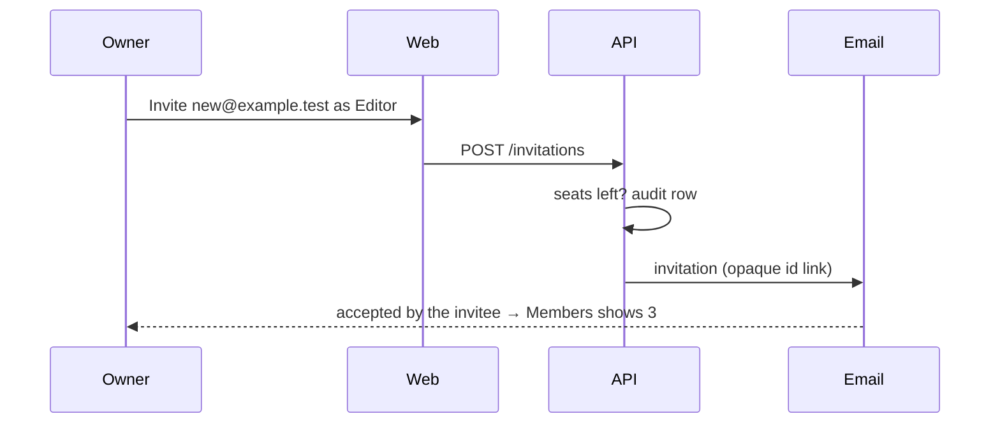

# Worked example: the `acme-k3p1` invitations epic (from the `epic` skill)

```
**One-way door.** The third migration drops `invite_tokens` after copying its pending rows; a revert does not bring the table back.
**Before merging:** take a Postgres snapshot. Confirm nobody needs the 3 accepted-but-not-yet-provisioned token rows (listed in acme-k3p1's notes).
**Undo:** `git revert -m 1 <merge sha>`, let it deploy. `invitations` and the `audit_log` column stay behind unused, harmless. `invite_tokens` only comes back from the snapshot.

## What changed
Workspace owners invite people by email from the Members page, see and revoke pending
invitations, and are refused cleanly when the workspace has no seats left. Every send,
accept, refusal and revoke is in the audit trail.



## Evidence

| Time | Step |
| --- | --- |
| 0:00 | 1. Members page: 2 rows and an Invite button |
| 0:22 | 2. Invite new@example.test as Editor; 1 pending; 1 email in Mailpit |
| 0:58 | 3. Accept in a clean profile; Members shows 3 |
| 1:50 | 4. Fourth invite refused: "no seats left"; Members still 3 |
| 2:35 | 5. Revoke; the link shows the revoked page |
| 3:10 | 6. Audit shows exactly 5 rows |

Times are from the walkthrough's chapters file. The player has no chapter menu; scrub to them.

## Signals
- **Schema:** `0041_invitations` creates `invitations` (additive). `0042_invitation_audit` adds nullable `invitation_id` to `audit_log` (additive). `0043_drop_invite_tokens` copies 0..n pending rows then `DROP TABLE invite_tokens` (data-moving, destructive). All run in the pre-deploy hook; the old build does not read `invite_tokens` after 0041, so the window is safe. One transaction each. No drift.
- **Data:** the copy keeps every pending token's email, role and expiry; accepted and expired tokens are not copied and go with the table.
- **Outside the system:** one invitation email per send and resend, to the address the owner typed. Nothing on deploy.
Checked and clear: auth (accept refuses a signed-in user whose email differs; nothing loosened), money, deploy, shared code.

## Review guide (about 15 minutes)
+2,418 / −611 across 47 files; 1,340 lines of product code, the rest tests (780), docs (190) and one picture; map at the end.
1. **The drop migration** — `risk` [0043_drop_invite_tokens.sql:1-19](https://github.com/acme/app/pull/312/files#diff-3f1c…R1-R19)
   Copies rows where `accepted_at IS NULL AND expires_at > now()`, then drops the table. **Check:** that WHERE clause is the definition of "pending" you are happy to lose everything outside of.
2. **Identity check on accept** — `security` [accept.ts:41-68](…R41-R68)
   Refuses when the signed-in email differs from the invitation's; never switches accounts. **Check:** the comparison is on the verified email, lower-cased on both sides, and the refusal writes an audit row before returning.
3. **Seat count read, not computed** — `judgment` [accept.ts:70-79](…R70-R79)
   Calls `workspaceSeats()` from acme-9wqz at accept time. **Check:** nothing in this PR counts seats itself (choice 1 below).
4. **Opaque id lookup** — `new pattern` [invitations.ts:12-34](…R12-R34)
   The link carries an id looked up server-side; beads .4 .5 .6 copy this shape. **Check:** the id is 128 bits from `crypto.randomBytes`, and lookup is by id and workspace.
5. **Shared email template** — `fan-out` [packages/email/src/invite.tsx:1-40](…R1-R40)
   Used by the web app and the admin tool. **Check:** the only new prop is optional.
Skim-safe: tests, 780 lines, one spec per bead, no `.skip`, no removed assertions; docs, 190 lines, the plan's §5 decision record and the members guide; the picture is the guide's retaken screenshot.

## Technical breakdown
- db: `invitations` table with opaque id, frozen role and 14-day expiry; `audit_log` gains an invitation reference; `invite_tokens` migrated and dropped.
- api: send, resend, revoke and accept over the table; four named refusals; one audit row per transition.
- web: Members page gains Invite, a pending list with Revoke, and the accept and revoked pages.
- email: one invitation template shared with the admin tool.
- Removed: the `/invite/<token>` route; old links now land on the revoked page.

## Choices made for you
- Pending means "not accepted and not expired"; accepted-but-unprovisioned tokens are dropped, because the plan's §5 says a token is spent on accept. One-way.

## Verification
Walkthrough: 6 steps passed, video above.
Full gate: lint, typecheck, 212 unit, 38 integration, 19 e2e, all green on 9f3c….
Simplify: 1 pass, 14 applied. Adversarial review: 9 findings, 7 fixed, 2 refuted.
Done means: every line ticked; evidence below.

<details><summary>Other choices</summary>

- The resend keeps one row and issues a new id, over keeping both, because the audit trail reads better. Reversible.
</details>

<details><summary>Diff map: 47 files by bucket</summary>

| Bucket | Files | Added | Removed |
| --- | --- | --- | --- |
| product | 19 | 1,340 | 402 |
| tests | 11 | 780 | 61 |
| docs | 4 | 190 | 148 |
| migrations | 3 | 71 | 0 |
| tracker | 1 | 36 | 0 |
| pictures | 1 | 0 | 0 |
</details>
```
